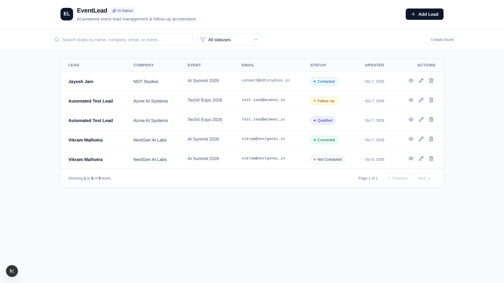
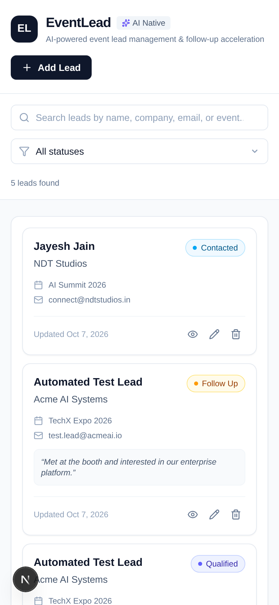

# EventLead — AI-Native Event Lead Manager

A full-stack, production-grade B2B SaaS application designed to capture, organize, summarize, and draft contextual follow-ups for event leads using **Next.js**, **FastAPI**, **SQLAlchemy 2.0**, **Neon PostgreSQL**, and **Google Gemini AI**.

---

## Assignment Context

Built as part of the Even8 AI Native Full Stack Intern assignment.

The project demonstrates:
- Full-stack CRUD application development
- REST API design with FastAPI
- PostgreSQL database persistence
- Gemini AI integration
- Responsive Next.js UI
- Search, filtering and pagination
- Production deployment

---

## Live Demo

[Open the Live Application](https://ai-event-lead-manager-five.vercel.app)

---

## Project Preview

| Dashboard (Desktop) | Phone View (Mobile) |
| :---: | :---: |
|  |  |

---

## Architecture Overview

```
Next.js / Vercel (Frontend)
        ↓ (NEXT_PUBLIC_API_BASE_URL)
FastAPI / Render (Backend)
        ↓
┌────────────────┴────────────────┐
▼                                 ▼
PostgreSQL / Neon (Database)      Gemini API (AI Orchestration)
```

- **Frontend (Vercel):** Single-page B2B dashboard built with Next.js App Router, React 19, and Tailwind CSS v4. Communicates strictly with the backend via `NEXT_PUBLIC_API_BASE_URL`. Never touches database credentials or AI API keys.
- **Backend (Render):** Layered asynchronous REST API built with FastAPI, SQLAlchemy 2.0, asyncpg, and Alembic. Manages validation, persistence, and server-side Gemini orchestration.
- **Database (Neon):** Serverless PostgreSQL database hosting the `leads` table with custom pipeline enums, constraints, and optimized composite indexes.
- **AI Engine (Google Gemini):** Server-side integration powered by `google-genai` executing prompt-injection guarded summarization and personalized follow-up generation.

---

## Tech Stack

| Layer | Technology | Key Libraries |
|---|---|---|
| **Frontend** | Next.js 16 (App Router) | React 19, Tailwind CSS v4, Lucide React, TypeScript |
| **Backend** | Python 3.11+ / FastAPI | Uvicorn, SQLAlchemy 2.0, Asyncpg, Pydantic v2, Google GenAI SDK |
| **Database** | Neon PostgreSQL (16+) | Serverless pooling, SSL/TLS, Alembic migrations |
| **AI** | Google Gemini API | `gemini-flash-lite-latest`, zero-leakage prompt isolation |
| **Testing** | Pytest, Httpx, Aiosqlite | Asynchronous integration & mock test suite (31 tests) |

---

## Key Features

1. **Lead Pipeline Management (CRUD):** Complete lifecycle tracking across 6 standard stages (`Not Contacted`, `Follow Up`, `Contacted`, `Qualified`, `Converted`, `Not Interested`).
2. **Server-Side Search & Filters:** Case-insensitive search across contact name, company, email, and event with real-time status filtering.
3. **Responsive UI:** Adapts between a desktop data table and mobile touch cards without horizontal scrolling.
4. **AI Executive Summary:** Synthesizes unstructured meeting notes into a concise factual briefing using Google Gemini.
5. **AI Follow-up Drafting:** Generates personalized follow-up messages tailored to the lead's event context and pipeline status with one-click clipboard copying.

---

## Local Setup & Development

### 1. Prerequisites
- Node.js 20+ & npm
- Python 3.11+ & pip

### 2. Environment Variables

Create `backend/.env` for local backend development:
```env
DATABASE_URL=postgresql+asyncpg://<username>:<password>@<neon-host>/<database>?sslmode=require
GEMINI_API_KEY=your_gemini_api_key_here
FRONTEND_URL=http://localhost:3000
ENVIRONMENT=development
```

Create `frontend/.env.local` for local frontend development:
```env
NEXT_PUBLIC_API_BASE_URL=http://localhost:8001
```

*(Note: If omitted, the frontend automatically defaults to relative `/api/v1` with Next.js rewrites to `http://localhost:8001` in local development).*

### 3. Backend Setup & Migrations
```bash
# Navigate to backend and install dependencies
cd backend
pip install -r requirements.txt

# Run Alembic migrations against Neon
alembic upgrade head

# Start FastAPI server
uvicorn app.main:app --host 127.0.0.1 --port 8001 --reload
```

### 4. Frontend Setup
```bash
# From workspace root or frontend/
npm install
npm run dev
```
Open [http://localhost:3000](http://localhost:3000) to view the application.

---

## API & Endpoints Overview

All REST endpoints are namespaced under `/api/v1`:

- `GET    /health` & `GET /api/v1/health` — Service health probe
- `GET    /api/v1/leads` — Paginated lead list (`search`, `follow_up_status`, `page`, `page_size`)
- `POST   /api/v1/leads` — Create lead (defaults status to "Not Contacted")
- `GET    /api/v1/leads/{lead_id}` — Retrieve single lead by UUID
- `PATCH  /api/v1/leads/{lead_id}` — Partial field update
- `DELETE /api/v1/leads/{lead_id}` — Remove lead (204 No Content)
- `POST   /api/v1/leads/{lead_id}/summarize` — AI notes summarization (Gemini)
- `POST   /api/v1/leads/{lead_id}/follow-up` — AI follow-up message draft (Gemini)

For full API payload schemas and examples, see [`backend/README.md`](./backend/README.md).

---

## Testing

Run the automated backend test suite:
```bash
pytest backend/tests -v
```
All 31 unit, integration, and mock AI tests execute against an isolated in-memory test database and never alter production data.

---

## Production Deployment Guide

### 1. Database (Neon PostgreSQL)
1. Create a project in [Neon Console](https://console.neon.tech).
2. Create or verify the `production` branch.
3. Copy the pooled connection string (`postgresql://...sslmode=require`).
4. Run migrations using Alembic:
   ```bash
   DATABASE_URL="<NEON_CONNECTION_STRING>" alembic upgrade head
   ```

### 2. Backend (Render)
1. Create a new **Web Service** on [Render](https://render.com).
2. Connect your Git repository.
3. Set the following configuration:
   - **Environment:** `Python 3`
   - **Root Directory:** `backend`
   - **Build Command:** `pip install -r requirements.txt && alembic upgrade head`
   - **Start Command:** `uvicorn app.main:app --host 0.0.0.0 --port $PORT`
4. Add Environment Variables in Render:
   - `DATABASE_URL`: Your Neon PostgreSQL pooled connection string.
   - `GEMINI_API_KEY`: Your Google Gemini API key.
   - `FRONTEND_URL`: Your Vercel frontend URL (e.g. `https://eventlead.vercel.app`).
   - `ENVIRONMENT`: `production`

### 3. Frontend (Vercel)
1. Import the project in [Vercel](https://vercel.com).
2. Set the following configuration:
   - **Framework Preset:** `Next.js`
   - **Root Directory:** `frontend`
3. Add Environment Variable in Vercel:
   - `NEXT_PUBLIC_API_BASE_URL`: `https://<render-backend-domain>` (e.g. `https://eventlead-backend.onrender.com`).
4. Deploy.

---

## Architectural Decisions & Trade-Offs

1. **Client-Side API Direct Calls vs Next.js Rewrites:**
   - In production, Next.js rewrites are omitted in favor of direct browser-to-backend communication via `NEXT_PUBLIC_API_BASE_URL`. This removes an unnecessary intermediate proxy hop, reduces serverless execution overhead on Vercel, and relies on standard CORS policies configured on FastAPI.
2. **URL Normalization in Frontend Service:**
   - The frontend API client automatically normalizes `NEXT_PUBLIC_API_BASE_URL` whether configured as `https://backend.onrender.com` or `https://backend.onrender.com/api/v1`, eliminating deployment configuration errors.
3. **Database-Side Search & Sorting:**
   - Case-insensitive search (`ILIKE`) and pagination execute directly in PostgreSQL using SQLAlchemy 2.0 expressions rather than loading full datasets into memory.
4. **Server-Side AI Isolation:**
   - Gemini API keys remain strictly confined to the backend environment. Untrusted user notes are encapsulated inside structured tags to prevent prompt injection.
